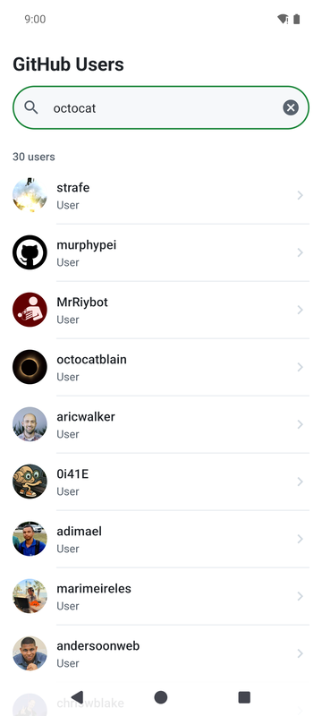
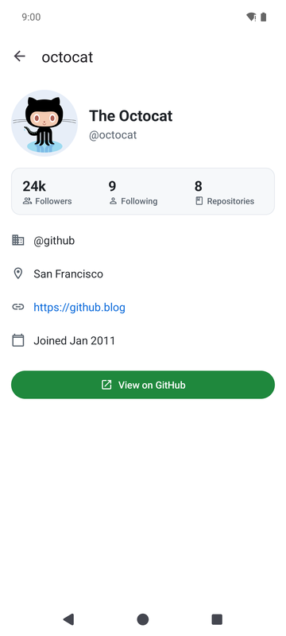
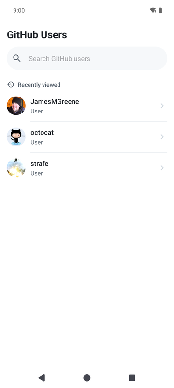
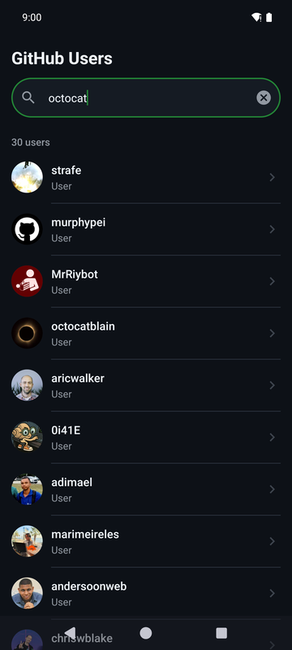
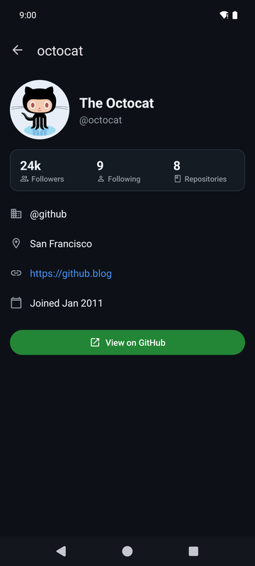
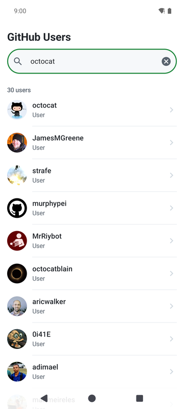
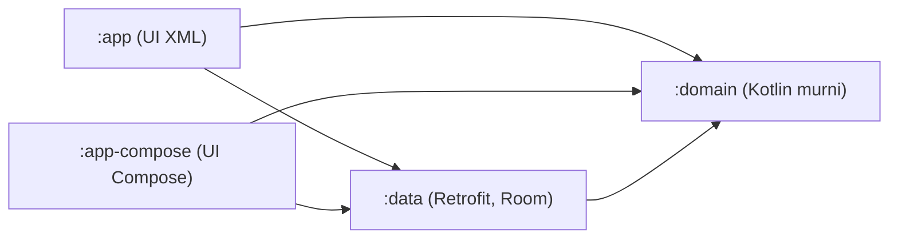

# GitHub User Search

[English](README.md) | Bahasa Indonesia

Aplikasi Android untuk mencari user GitHub dan melihat profilnya, dibuat untuk assessment HCS-IDN. Ketik nama, dapat daftar akun yang cocok, buka salah satu untuk melihat followers, repository dan info kontak. Semua yang sudah pernah dibuka tetap bisa dilihat saat offline.

Hasil utamanya adalah aplikasi XML di `:app`. Saya juga menulis versi Jetpack Compose (`:app-compose`) di atas modul domain dan data yang sama persis, terutama untuk membuktikan bahwa layer-nya benar-benar terpisah, bukan sekadar beda folder.

<table>
  <tr>
    <td></td>
    <td></td>
    <td></td>
  </tr>
  <tr>
    <td></td>
    <td></td>
    <td></td>
  </tr>
</table>

## Aplikasi Android yang saya bangun dan maintain

Repository ini dibuat untuk assessment, tetapi kebiasaan kerjanya sama dengan yang saya pakai di aplikasi Android yang sudah live di Google Play dan masih saya kembangkan serta maintain sampai sekarang:

- [Olsera POS](https://play.google.com/store/apps/details?id=com.olserapratama.pos), aplikasi kasir untuk bisnis retail dan F&B, 100K+ download di Google Play.
- [Simpel POS](https://play.google.com/store/apps/details?id=com.simpel.pos), aplikasi kasir online untuk UMKM.

## Build dan menjalankan

Butuh Android Studio Ladybug atau lebih baru, atau cukup JDK 17 dan Android SDK untuk command line. Project dibuild lewat Gradle wrapper, jadi tidak ada yang perlu diinstall lagi.

```
./gradlew :app:installDebug           # aplikasi XML (hasil utama)
./gradlew :app-compose:installDebug   # versi Compose
```

Kedua aplikasi punya application id berbeda (`com.tisto.githubusers` dan `com.tisto.githubusers.compose`), jadi bisa terpasang berdampingan.

**Rate limit GitHub.** Tanpa autentikasi, search API hanya mengizinkan sekitar 10 request per menit. Untuk testing intensif, tambahkan personal access token (tanpa scope) ke `local.properties`:

```
github.token=ghp_tokenanda
```

File itu di-ignore git. Token bersifat opsional: tanpa token, `BuildConfig` memakai string kosong dan header auth tidak dikirim, begitu juga di CI.

**Test.**

```
./gradlew testDebugUnitTest            # unit test JVM, semua modul
./gradlew connectedDebugAndroidTest    # UI test Espresso + Compose, perlu device atau emulator
```

**APK siap pakai** ada di halaman [release v1.0.0](https://github.com/TistoW/github-user-search/releases/tag/v1.0.0). APK itu ditandatangani dengan debug key, hanya supaya reviewer bisa menginstalnya.

**Chucker.** Build debug mencatat semua panggilan HTTP dengan Chucker. Di Android 13 ke atas, izinkan notifikasi saat diminta (atau lewat pengaturan sistem), lalu tap notifikasi Chucker setelah melakukan pencarian. Bisa juga dengan menekan lama ikon aplikasi dan memilih shortcut Chucker. Build release memakai artifact no-op, jadi tidak ada yang dicatat.

## Arsitektur

MVVM di atas Clean Architecture, dipecah menjadi modul Gradle supaya aturan dependency ditegakkan oleh compiler, bukan sekadar kesepakatan.



- `:domain` adalah modul Kotlin biasa: model (`User`, `UserDetail`, `DataError`), kontrak `UserRepository` dan use case kecil. Tidak ada dependency Android, jadi tidak mungkin tidak sengaja meng-import-nya.
- `:data` mengimplementasikan kontrak itu dengan Retrofit/OkHttp/Moshi untuk network dan Room untuk cache. Modul UI hanya melihatnya lewat Hilt.
- `:app` dan `:app-compose` berisi presentation: ViewModel, UI state dan screen. Keduanya tidak tahu apa itu Room atau Retrofit.

**Kenapa MVVM, bukan MVP.** ViewModel sadar lifecycle dan bertahan saat rotasi, jadi tidak ada presenter yang harus dilepas dan dipasang manual. Cocok juga dengan state yang bisa di-observe: LiveData di app XML, StateFlow di app Compose. Use case yang sama dipakai keduanya.

**Offline-first, Room sebagai single source of truth.** UI tidak pernah membaca response network langsung. Pencarian menulis ke Room, dan layar mengobservasi Room, jadi hasil cache muncul seketika dan panggilan network hanya menyegarkannya.

- User disimpan sekali, berisi kolom ringkasan (dari pencarian) dan kolom detail (dari panggilan profil).
- Hasil pencarian ada di tabel `search_results` terpisah dengan key query yang dinormalisasi (di-trim dan lowercase) ditambah posisi, jadi "Octocat" dan "octocat " memakai satu entri cache dan urutan dari GitHub terjaga.
- Upsert dilakukan dengan insert-ignore lalu partial update. `REPLACE` biasa menghapus dan menyisipkan ulang baris, sehingga profil yang sudah di-cache hilang saat user itu muncul di pencarian berikutnya, dan lewat cascade foreign key hasil pencarian yang menunjuk ke baris itu ikut terhapus. Partial update hanya menyentuh kolom yang memang dibawa oleh response.
- Panggilan network yang gagal tidak mengubah cache.
- "Recently viewed" adalah timestamp di baris user, dibatasi 20 terakhir.

**Error menjadi UI state.** Data layer memetakan setiap kegagalan ke `DataError`: `Network` (tidak ada koneksi), `RateLimited` (403 dengan `X-RateLimit-Remaining: 0`, atau 429, beserta waktu reset), `NotFound` (404) dan `Unknown`. 403 biasa sengaja tidak dianggap rate limit. UI lalu memilih kalimat sesuai konteks: offline dengan hasil cache berkata "Showing saved results", offline tanpa cache menampilkan "Nothing saved for this search yet", rate limit menyebut berapa menit harus menunggu, dan akun yang tidak ada punya layar sendiri dengan jalan kembali. Error muncul sebagai snackbar sekali tampil dengan tombol Retry, jadi tidak muncul lagi setelah rotasi.

**Dependency injection** memakai Hilt. `:data` menyediakan network, database dan repository. Token GitHub opsional adalah `String` dengan qualifier `@GitHubToken` yang di-bind oleh masing-masing modul app dari `BuildConfig`-nya sendiri, sehingga `:data` bebas dari konfigurasi khusus app.

## Library

| Kebutuhan | Yang saya pakai |
|---|---|
| Networking | Retrofit 2 + OkHttp, Moshi (codegen) |
| Gambar | Glide, integrasi Glide Compose |
| Cache lokal | Room |
| DI | Hilt |
| Async | Kotlin Coroutines dan Flow |
| Presentation | ViewModel, LiveData (XML) dan StateFlow (Compose), ViewBinding |
| Navigasi | Navigation component + Safe Args (XML), Navigation Compose type-safe |
| Debugging | Chucker (hanya debug, no-op di release) |
| Build | Gradle Version Catalog, R8 dengan shrinking di release |
| Unit test | JUnit, MockK, coroutines-test, Turbine, Robolectric, MockWebServer |
| UI test | Espresso dengan Hilt (fake repository), Compose UI test |
| CI | GitHub Actions: unit test, lint, build, UI test di emulator |

## Di luar brief

- Versi Jetpack Compose lengkap yang memakai ulang `:domain` dan `:data` tanpa mengubah satu baris pun.
- Daftar "Recently viewed" di layar pencarian yang kosong.
- Offline-first dengan pesan offline dan rate limit yang berbeda, bukan satu error generik.
- Debounce 400 ms saat mengetik, sementara tombol search di keyboard dan Retry mencari langsung.
- Pull to refresh di layar detail.
- Dark mode dan layout landscape.
- Build release diperiksa di device di bawah R8, bukan sekadar dibuild.
- CI yang juga menjalankan UI test di emulator.

## Tantangan

- **Detail cache yang terhapus.** Upsert yang paling jelas adalah `REPLACE`, dan itu jebakan di sini. `REPLACE` menghapus lalu menyisipkan ulang baris, jadi user yang dibuka dari daftar kehilangan profil cache-nya saat pencarian berikutnya mengembalikannya, dan hasil pencarian yang menunjuk ke baris itu hilang lewat cascade. Saya memakai insert-ignore plus partial update, dan test DAO mengunci perilaku itu.
- **Debounce versus submit eksplisit.** Debounce tepat untuk mengetik tapi salah untuk tombol search, jadi submit melewatinya. Ini juga menentukan cara kerja test Espresso: timer coroutine tidak terlihat oleh Espresso, jadi test mencari lewat IME action dengan fake repository, bukan dengan sleep. Ikon clear hanya muncul saat field punya fokus, dan ini baru ketahuan ketika sebuah test gagal.
- **Keyboard menutupi empty state.** Dengan edge-to-edge aktif, pesan kosong tersembunyi di balik keyboard. Solusinya menangani inset IME di root layar dan memberi inset navigation bar hanya ke list, jadi list tetap bisa di-scroll di bawah bar.
- **Build release Compose gagal.** Ikon vector disalin dari app XML dengan `tint="?attr/colorControlNormal"`. Tema Compose tidak punya atribut itu, debug masih mentoleransi tetapi langkah resource di release tidak. Compose mewarnai ikon sendiri, jadi atribut itu saya hapus.
- **Rate limit pencarian.** Sepuluh request per menit tanpa autentikasi mudah tercapai saat testing. Membedakan rate limit dari 403 biasa butuh header `X-RateLimit-Remaining`, dan pesannya menampilkan waktu reset.
- **Tanggal di minSdk 24.** `java.time` butuh desugaring di bawah API 26, jadi "Joined Jan 2011" diformat dengan `SimpleDateFormat` di UTC, tidak menambah library hanya untuk satu string. Lint juga menemukan `paddingVertical` API 26 di sebuah style saat saya menambah CI.

## Keterbatasan dan langkah berikutnya

- Pencarian hanya menampilkan 30 hasil pertama. Langkah berikutnya yang wajar adalah Paging 3 dengan `RemoteMediator` di atas tabel Room yang sudah ada.
- Cache tidak pernah kedaluwarsa. Time-to-live per user, memakai waktu fetch yang sudah disimpan, akan jadi kebijakan pertama yang ditambah.
- Kedua modul UI menduplikasi beberapa hal (string, helper format, kalimat error). Modul bersama yang kecil bisa menghilangkannya.
- APK release ditandatangani dengan debug key, memang disengaja, supaya bisa direview tanpa keystore privat.
- Token GitHub opsional masuk ke `BuildConfig`, aman sebagai alat bantu debug lokal tapi bukan untuk dirilis.

## Test

| Modul | Unit test | UI test |
|---|---|---|
| `:domain` | 6 | |
| `:data` (Room via Robolectric, API via MockWebServer, repository) | 36 | |
| `:app` | 18 | 6 (Espresso, Hilt, fake repository) |
| `:app-compose` | 18 | 9 (8 level screen, 1 alur end-to-end) |
| Total | 78 | 15 |

CI menjalankan unit test, lint dan build debug di setiap push, ditambah UI test di emulator API 34.
