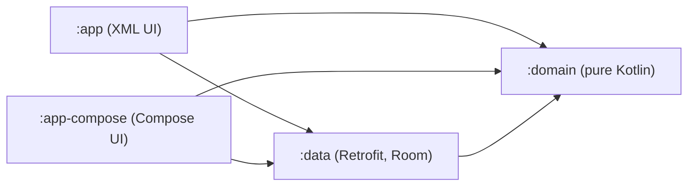

# GitHub User Search

English | [Bahasa Indonesia](README.id.md)

An Android app that searches GitHub users and shows their profile, built for the HCS-IDN assessment. You type a name, get a list of matching accounts, open one to see followers, repositories and contact details, and everything you have already seen keeps working offline.

The main deliverable is the XML app in `:app`. I also wrote the same app in Jetpack Compose (`:app-compose`) on top of the exact same domain and data modules, mostly to prove the layers are decoupled for real and not just by folder name.

The brief lists a "Search screen" and a "User list screen". Here they are one screen on purpose: the search results are the user list, and a second screen would only hold a text field above the same list. With an empty query that screen shows the recently viewed users instead of nothing. The detail screen is the second one.

<table>
  <tr>
    <td></td>
    <td></td>
    <td></td>
  </tr>
  <tr>
    <td></td>
    <td></td>
    <td></td>
  </tr>
</table>

## Production work

This repository is an assessment, but it follows the same habits I use on Android apps that are live on Google Play and that I still develop and maintain today:

- [Olsera POS](https://play.google.com/store/apps/details?id=com.olserapratama.pos), a point-of-sale app for retail and F&B businesses, 100K+ downloads on Google Play.
- [Simpel POS](https://play.google.com/store/apps/details?id=com.simpel.pos), a cashier app for small businesses (UMKM).
- [SBB Shop](https://play.google.com/store/apps/details?id=id.sikapaiyabb), an online shop with an Android app and a web storefront at [sikapaiyabb.id](https://sikapaiyabb.id). Both run on the same backend, so products and orders stay in sync between them.

On the web side, these are full-stack products I built and run, in case they help as reference:

- [zenenta.com](https://zenenta.com): POS, inventory, cash flow, payables and receivables, financial reports and marketplace integration for Indonesian small businesses, with its own Android POS app.
- [chatsaya.com](https://chatsaya.com): an AI assistant that answers customer chats on WhatsApp, Instagram and Messenger, with hand-over to a human agent at any time.
- [umkdigital.id](https://umkdigital.id): a platform for Indonesian small businesses covering training, exhibitions, funding and collaboration, used for the small businesses mentored by Telkom Indonesia.
- [dikebut.com](https://dikebut.com): a white-label shipping aggregator, one API for many couriers.

## Build and run

You need Android Studio Meerkat (2024.3.1) or newer, or just a JDK 17 and the Android SDK for the command line. The project builds with the Gradle wrapper, so nothing else has to be installed.

```
./gradlew :app:installDebug           # the XML app (main deliverable)
./gradlew :app-compose:installDebug   # the Compose version
```

The two apps have different application ids (`com.tisto.githubusers` and `com.tisto.githubusers.compose`), so they install side by side.

**GitHub rate limits.** Unauthenticated, GitHub applies two limits: the search API allows 10 requests per minute, and every other endpoint, including the profile on the detail screen, allows 60 requests per hour per IP. For heavy testing, add a personal access token (no scopes needed) to `local.properties`:

```
github.token=ghp_yourtoken
```

That file is git-ignored. The token is optional: without it `BuildConfig` falls back to an empty string and no auth header is sent, which is also how CI builds.

**Tests.**

```
./gradlew testDebugUnitTest            # JVM unit tests, all modules
./gradlew connectedDebugAndroidTest    # Espresso + Compose UI tests, needs a device or emulator
```

**Prebuilt APKs** are attached to the [v1.0.1 release](https://github.com/TistoW/github-user-search/releases/tag/v1.0.1). They are signed with the debug key, only so reviewers can install them.

**Chucker.** Debug builds log every HTTP call with Chucker. On Android 13 and newer, grant the notification permission when asked (or in system settings), then tap the Chucker notification after a search. You can also long-press the app icon and pick the Chucker shortcut. Release builds use the no-op artifact, so nothing is logged there.

## Architecture

MVVM on top of Clean Architecture, split into Gradle modules so that the dependency rule is enforced by the compiler instead of by convention.



- `:domain` is a plain Kotlin module: models (`User`, `UserDetail`, `DataError`), the `UserRepository` contract and small use cases. It has no Android dependency, so it cannot accidentally import one.
- `:data` implements the contract with Retrofit/OkHttp/Moshi for the network and Room for the cache. The UI modules only see it through Hilt.
- `:app` and `:app-compose` hold presentation: ViewModels, UI state and screens. Neither knows what Room or Retrofit is.

**Why MVVM and not MVP.** The ViewModel is lifecycle-aware and survives rotation, so there is no presenter to detach and re-attach by hand. It also fits observable state naturally: LiveData in the XML app, StateFlow in the Compose one. The same use cases feed both.

**Offline-first, Room as the single source of truth.** The UI never reads the network response directly. A search writes into Room, and the screen observes Room, so cached results appear immediately and the network call only refreshes them.

- Users are stored once, with summary fields (from search) and detail fields (from the profile call).
- Search results live in a separate `search_results` table keyed by the normalized query (trimmed, lowercased) plus a position, so "Octocat" and "octocat " share one cache entry and the order from GitHub is preserved.
- Upserts are insert-ignore followed by a partial update. A plain `REPLACE` deletes and re-inserts the row, which would wipe the cached profile of a user who shows up in a later search, and through the foreign key cascade would delete the search results that point at it. The partial update only touches the columns the response actually carries.
- A failed network call leaves the cache untouched.
- "Recently viewed" is a timestamp on the user row, limited to the latest 20.

**Errors become UI states.** The data layer maps every failure to a `DataError`: `Network` (no connection), `RateLimited` (403 with `X-RateLimit-Remaining: 0`, or 429, with the reset time), `NotFound` (404) and `Unknown`. A plain 403 is deliberately not a rate limit. The UI then picks wording by context: offline with cached results says "Showing saved results", offline with nothing cached shows "Nothing saved for this search yet", a rate limit says how many minutes to wait (worded for the search limit on the list and for the general API limit on a profile, with its own empty state instead of the offline one), and a missing account shows a dedicated screen with a way back. Errors are one-shot snackbars with Retry, so they do not reappear after rotation.

**Dependency injection** is Hilt. `:data` provides the network, database and repository. The optional GitHub token is a `@GitHubToken` qualified `String` that each app module binds from its own `BuildConfig`, which keeps `:data` free of any app-specific configuration.

## Libraries

| Requirement | What I used |
|---|---|
| Networking | Retrofit 2 + OkHttp, Moshi (codegen) |
| Images | Glide, Glide Compose integration |
| Local cache | Room |
| DI | Hilt |
| Async | Kotlin Coroutines and Flow |
| Presentation | ViewModel, LiveData (XML) and StateFlow (Compose), ViewBinding |
| Navigation | Navigation component + Safe Args (XML), type-safe Navigation Compose |
| Debugging | Chucker (debug only, no-op in release) |
| Build | Gradle Version Catalog, R8 with shrinking in release |
| Unit tests | JUnit, MockK, coroutines-test, Turbine, Robolectric, MockWebServer |
| UI tests | Espresso with Hilt (fake repository), Compose UI test |
| CI | GitHub Actions: unit tests, lint, build, emulator UI tests |

## Beyond the brief

- A full Jetpack Compose version that reuses `:domain` and `:data` without changing a line of them.
- A "Recently viewed" list on the empty search screen.
- Offline-first with distinct offline and rate-limit messages instead of one generic error.
- A 400 ms debounce on typing, while the keyboard search button and Retry search immediately.
- Pull to refresh on the detail screen.
- Dark mode and landscape layouts.
- Release builds checked under R8 on a device, not only built.
- CI that also runs the UI tests on an emulator.

## Challenges

- **Cached details getting wiped.** The obvious upsert is `REPLACE`, and it is a trap here. It deletes and re-inserts the row, so a user opened from the list would lose the cached profile the next time a search returned them, and the search results pointing at that row would vanish through the cascade. I used insert-ignore plus partial updates instead, and DAO tests pin that behaviour.
- **Debounce versus explicit submit.** Debouncing is right for typing but wrong for the search key, so submit bypasses it. This also decided how the Espresso tests work: coroutine timers are invisible to Espresso, so the tests search through the IME action with a fake repository instead of sleeping. The clear icon only shows while the field has focus, which I only found by watching a test fail.
- **The keyboard covering the empty state.** With edge-to-edge enabled, the empty message hid behind the keyboard. The fix was to handle the IME inset on the screen root and give the navigation bar inset to the list only, so the list still scrolls under the bar.
- **Compose release build failing.** The vector icons were copied from the XML app with `tint="?attr/colorControlNormal"`. The Compose theme has no such attribute, debug tolerated it and the release resource step did not. Compose tints icons itself, so I removed the attribute.
- **The search rate limit.** Ten requests per minute unauthenticated is easy to hit while testing. Telling a rate limit apart from an ordinary 403 needed the `X-RateLimit-Remaining` header, and the message shows the reset time.
- **Dates on minSdk 24.** `java.time` needs desugaring below API 26, so "Joined Jan 2011" is formatted with `SimpleDateFormat` in UTC instead of adding a library for one string. Lint also caught an API 26 `paddingVertical` in a style when I added CI.

## Limitations and next steps

- Search shows the first 30 results only. The natural next step is Paging 3 with a `RemoteMediator` on top of the existing Room tables.
- The cache never expires. A time-to-live per user, using the stored fetch time, would be the first policy to add.
- The two UI modules duplicate a few things (strings, formatting helpers, error wording). A small shared module would remove that.
- The release APK is signed with the debug key, on purpose, so it can be reviewed without a private keystore.
- The optional GitHub token ends up in `BuildConfig`, which is fine for a local debug aid but not something to ship.

## Tests

| Module | Unit tests | UI tests |
|---|---|---|
| `:domain` | 6 | |
| `:data` (Room via Robolectric, API via MockWebServer, repository) | 38 | |
| `:app` | 18 | 7 (Espresso, Hilt, fake repository) |
| `:app-compose` | 18 | 10 (9 screen-level, 1 end-to-end flow) |
| Total | 80 | 17 |

CI runs the unit tests, lint and a debug build on every push, plus the UI tests on an API 34 emulator.
